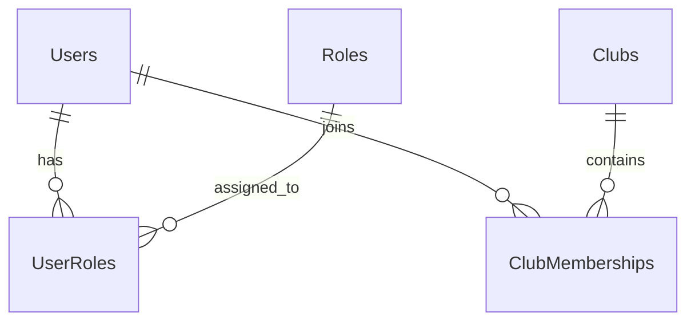

# Societas — Aşama 01 ER Taslağı

## Amaç

Kullanıcıları, sistem rollerini, kulüpleri ve
bunlarla ilişkili kayıtları temsil eden ilk
veritabanı taslağını belgelemek.

## Tablolar

- Users: Kullanıcı bilgileri
- Roles: Sistem rolleri
- UserRoles: Kullanıcı ve sistem rolü ilişkisi
- Clubs: Kulüp bilgileri
- ClubMemberships: Kullanıcı ve kulüp üyeliği ilişkisi

## ER Diyagramı



## İlk Şema Kararları

1. Tabloların kayıtları birincil anahtarlarla tanımlanır.
2. Users.Email benzersiz olmalıdır.
3. Roles.RoleName benzersiz olmalıdır.
4. Clubs.ClubName benzersiz olmalıdır.
5. UserRoles, UserID ve RoleID bileşik
   birincil anahtarını kullanır.
6. ClubMemberships, ClubID ve UserID bileşik
   birincil anahtarını kullanır.
7. İlişkiler yabancı anahtarlarla korunur.
8. Gerçek kullanıcı parolaları düz metin olarak
   saklanmamalıdır.

## Mevcut Durum

Beş tablonun oluşturulduğu doğrulandı.
Kullanıcı-rol ilişkisi ve temel benzersizlik
kuralları test edildi.

ER taslağı ilk sürümdür; tüm sütunlar ve
kısıtlar son şema kontrolüyle karşılaştırılacaktır.
```
